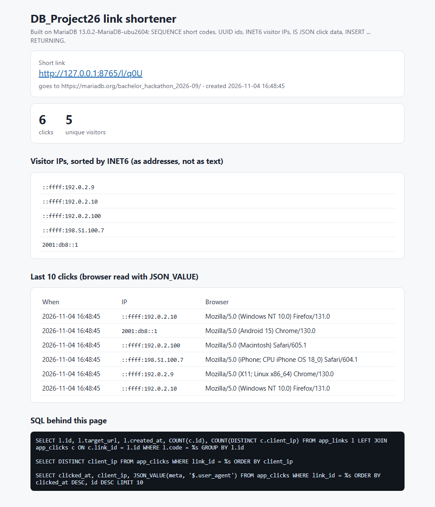
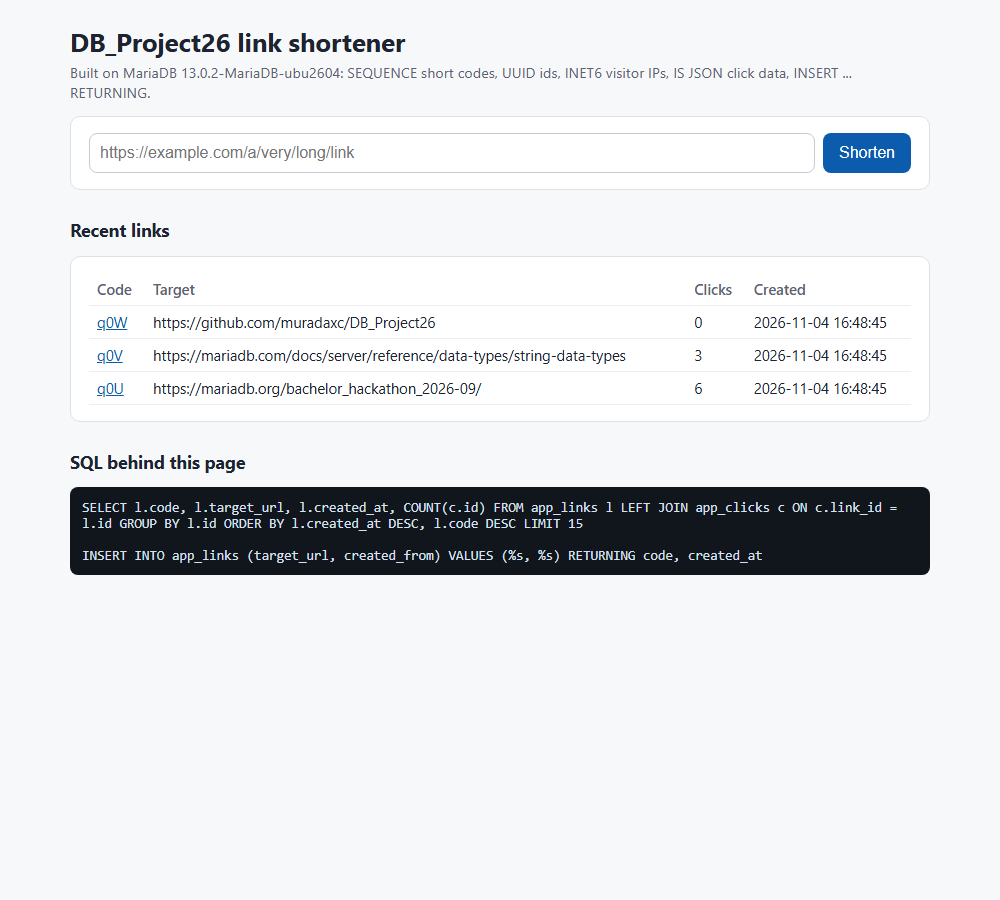
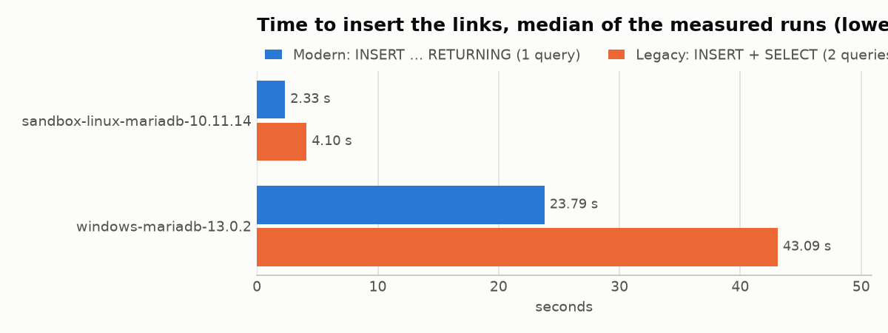
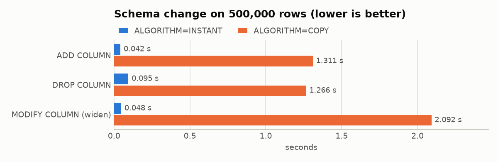
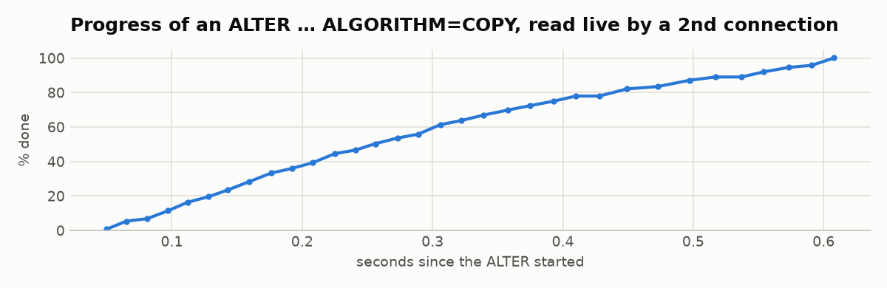
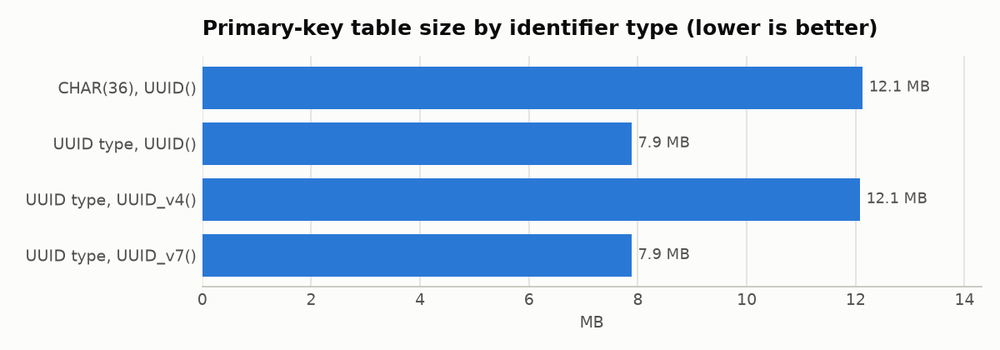

A project for area 1, "SQL that saves you work" for the [MariaDB student database projects, 2026-09](https://mariadb.org/bachelor_hackathon_2026-09/).

# DB_Project26: a link shortener built twice, with and without MariaDB's newer SQL features


**Team:** Mahammad Ismayilov ([@Mago06-bit](https://github.com/Mago06-bit)), Murad Jafarov ([@muradaxc](https://github.com/muradaxc)), Muhammed Abdullayev
**MariaDB version developed against:** 13.0.2 (official `mariadb` Docker image, pinned in `docker-compose.yml`)

We built a small, working **link shortener** (shorten a link, open it, see who clicked) on MariaDB's
newer SQL features, then wrote **the same jobs the old way** and measured what each feature saves:
queries, bytes, seconds, and errors. The project covers **all 13 features** that area 1 lists. One of
them, global temporary tables, turned out not to exist yet in 13.0.2; we report the server's error.



## Learn area 1 in six statements

```sql
-- 1. The server makes the id and hands back what it made: no second SELECT.
INSERT INTO links (target_url) VALUES ('https://example.com') RETURNING id, created_at;

-- 2. 16-byte ids and real IP addresses instead of text.
CREATE OR REPLACE TABLE clicks (link_id UUID NOT NULL, client_ip INET6 NOT NULL);

-- 3. Short codes from a sequence that belongs to no single table.
CREATE SEQUENCE code_seq START WITH 100000;

-- 4. The database refuses bad data, whoever sends it.
ALTER TABLE app_clicks ADD CONSTRAINT meta_ok CHECK (meta IS JSON);

-- 5. Change a big table's columns without rebuilding it.
ALTER TABLE links ADD COLUMN note VARCHAR(50) NULL, ALGORITHM=INSTANT;

-- 6. Name the rows to change once, then UPDATE or DELETE them (12.3+).
WITH stale AS (SELECT l.id FROM links l LEFT JOIN clicks c ON c.link_id = l.id WHERE c.link_id IS NULL)
DELETE FROM links WHERE id IN (SELECT id FROM stale);
```

One command runs every test and measurement and rebuilds this README's tables and charts:
`python python/run_all.py` (see [How to run it](#how-to-run-it)).

## Results at a glance

<!-- BEGIN:glance -->
| Result | Measured |
|---|---|
| Link inserts with `RETURNING` vs. insert + `SELECT` | **1.8× faster** (23.8 s vs 43.1 s, 1 vs 2 queries per insert) |
| `UUID` type vs `CHAR(36)` (primary key table) | **35% smaller** |
| `ADD COLUMN` with `ALGORITHM=INSTANT` vs `COPY` | **31× faster** |
| Reader errors while the schema is re-run (200×): `DROP`+`CREATE` vs `CREATE OR REPLACE` | **380 vs 0** |
| Bad JSON documents stored when a 2nd client skips the app | **100 vs 0** (app check vs `IS JSON` constraint) |
| Deleting 10,000 stale links: app loop vs `WITH … DELETE` | **138× faster**, 10,001 vs 1 statements |

<sub>Primary machine: `windows-mariadb-13.0.2` (MariaDB 13.0.2-MariaDB-ubu2604, Windows-11-10.0.26200-SP0, 16 CPUs, Python 3.15.2, measured 2026-11-04). Medians of the measured runs; ranges below.</sub>
<!-- END:glance -->

### Contents

- [Results at a glance](#results-at-a-glance)
- [The features, and where each one is used](#the-features-and-where-each-one-is-used)
- [The app](#the-app)
- [Side by side](#side-by-side)
- [Data model and why it looks like this](#data-model-and-why-it-looks-like-this)
- [Measured results](#measured-results)
- [Second machine and version comparison](#second-machine-and-version-comparison)
- [How to run it](#how-to-run-it)
- [Tests and CI](#tests-and-ci)
- [How it was made](#how-it-was-made)
- [Repository map](#repository-map)
- [Findings worth knowing](#findings-worth-knowing)
- [When is each feature worth it?](#when-is-each-feature-worth-it)
- [Limitations](#limitations)
- [Lessons and what we would change](#lessons-and-what-we-would-change)
- [Why MariaDB for this?](#why-mariadb-for-this)
- [Team](#team)

## The features, and where each one is used

| Feature (area 1 list) | Used in the app / comparison | Measured in | Example |
|---|---|---|---|
| `INET4` / `INET6` | visitor IPs (`app_clicks.client_ip`, `clicks.client_ip`) | `sizes.py`, `demo.py` | `02_inet.sql` |
| `UUID` (+ `UUID_v4()`, `UUID_v7()`) | link ids | `sizes.py`, `demo.py` | `01_uuid.sql` |
| `RETURNING` | creating a link | `demo.py` | `03_returning.sql` |
| `CREATE SEQUENCE` | short codes (`app_code_seq`) | – | `05_sequence.sql` |
| `INTERSECT` / `EXCEPT` | – | – | `06_set_operations.sql` |
| `CREATE OR REPLACE` | every schema file | `features.py` (re-runs under load) | `04_create_or_replace.sql` |
| `IS JSON` | `CHECK` on click details (`app_clicks.meta`) | `features.py` | `08_is_json.sql` |
| Invisible columns | `app_links.created_from` | – | `07_invisible_column.sql` |
| `ROW` type | – | – | `09_row_type.sql` |
| Instant `ADD`/`DROP`/`MODIFY COLUMN` | – | `migration.py` | – |
| Progress reporting | – | `migration.py` | `12_progress_reporting.sql` |
| Global temporary tables (12.3) | – | `features.py` (not in 13.0.2, see Findings) | `11_global_temporary_table.sql` |
| `UPDATE`/`DELETE` reading from CTEs (12.3) | – | `features.py` | `10_cte_update_delete.sql` |

## The app

`python python/app.py` starts a link shortener on <http://127.0.0.1:8000> (Python standard library
only, no web framework). You paste a long link and get a short one; opening the short link logs the
click and redirects; each link has a statistics page. Every page prints the SQL it ran.



How the features carry it (`sql/03_app.sql`, `python/app.py`):

- **`CREATE SEQUENCE`** gives each link a number (`DEFAULT NEXTVAL(app_code_seq)`), shown as a short
  base-62 code such as `q0U`. No counter in the application, no `AUTO_INCREMENT` tied to one table.
- **`INSERT … RETURNING code, created_at`** creates the link and returns its code in one round trip.
- **`UUID`** is the internal key; the guessable sequence number is only the public code.
- **`INET6`** stores IPv4 and IPv6 visitors in one column, and the statistics page sorts them as
  addresses (`192.0.2.9` before `192.0.2.10`), which text cannot do.
- **`CHECK (meta IS JSON)`** guards the click details (browser, referrer). The statistics page reads
  them back with `JSON_VALUE`.
- An **invisible column** (`created_from`) records who created a link without showing up in
  `SELECT *`.

`python python/app.py --demo-data` adds three example links and clicks from documentation-only IP
ranges (192.0.2.0/24, 198.51.100.0/24, 2001:db8::/32), which is what the screenshots show.

## Side by side

**Schema.** Modern (`sql/01_modern.sql`):

```sql
CREATE OR REPLACE TABLE links (
  id UUID DEFAULT UUID() PRIMARY KEY,
  target_url VARCHAR(2048) NOT NULL,
  created_at TIMESTAMP DEFAULT CURRENT_TIMESTAMP
);
```

Legacy (`sql/02_legacy.sql`):

```sql
DROP TABLE IF EXISTS links_legacy;          -- the "DROP IF EXISTS dance"
CREATE TABLE links_legacy (
  id CHAR(36) PRIMARY KEY,                  -- 36 bytes of text instead of a 16-byte UUID
  target_url VARCHAR(2048) NOT NULL,
  created_at TIMESTAMP DEFAULT CURRENT_TIMESTAMP
);
```

**Inserting a link and getting its id and timestamp back.**

```python
# Modern: one query. The server makes the UUID and the timestamp and RETURNING sends them back.
cur.execute("INSERT INTO links (target_url) VALUES (%s) RETURNING id, created_at", (url,))
link_id, created_at = cur.fetchone()

# Legacy: two queries. We invent the id in Python, insert, then ask again for created_at.
new_id = str(uuid.uuid4())
cur.execute("INSERT INTO links_legacy (id, target_url) VALUES (%s, %s)", (new_id, url))
cur.execute("SELECT created_at FROM links_legacy WHERE id = %s", (new_id,))
```

**Validation.** Legacy: the application checks JSON before inserting, so anything that does not go
through the application (an import script, a manual fix) is not checked. Modern:

```sql
CONSTRAINT click_meta_is_json CHECK (meta IS JSON)   -- the database checks every writer
```

**Removing links nobody clicked.** Legacy: select the ids into the application, then one `DELETE`
per id (or nest the query as a derived table). Modern (12.3+):

```sql
WITH stale AS (SELECT l.id FROM links l LEFT JOIN clicks c ON c.link_id = l.id WHERE c.link_id IS NULL)
DELETE FROM links WHERE id IN (SELECT id FROM stale);
```

All eight comparisons, each with its old-way twin, are in `python/` and `examples/`.

## Data model and why it looks like this

- `links(id UUID, target_url, created_at)` and `clicks(id, link_id → links.id, client_ip INET6,
  clicked_at)`: the modern comparison tables.
- `links_legacy` / `clicks_legacy`: the same shape with `CHAR(36)` ids and `VARCHAR(45)` IPs.
- `app_links(id UUID, code from app_code_seq, target_url, created_at, created_from INET6 INVISIBLE)`
  and `app_clicks(id, link_id → app_links.id, client_ip INET6, meta CHECK IS JSON, clicked_at)`: the
  web app's tables. They are separate from the comparison tables so that using the app never changes
  the benchmark's table sizes.

Why it looks like this:

- **UUID ids instead of auto-increment.** Sequential numbers let anyone count or guess other links,
  and UUIDs can be made on any server without coordination. The cost is a bigger key, which the
  `UUID` type keeps at 16 bytes instead of the 36 of `CHAR(36)`. The public short code is a separate
  sequence number, because a 36-character id would not be short.
- **`INET6` instead of `INET4`.** Visitors arrive over IPv4 or IPv6, and `INET4` cannot hold IPv6.
  `INET6` holds both (IPv4 as `::ffff:a.b.c.d`) and sorts and compares them as addresses, not text.
- **A separate clicks table.** One link gets many clicks. Keeping them apart avoids repeating the URL
  on every click and makes per-link counts a simple `GROUP BY`; the `(link_id, clicked_at)` index
  serves the statistics page.
- **`created_at` set by the server.** The database clock is the single source of truth, which is
  exactly the value the legacy version has to fetch with a second query.
- **Click details as JSON.** Browser and referrer vary and are only displayed, never joined on, so a
  checked JSON column is simpler than extra tables.

## Measured results

Every number below is generated from the JSON files in `results/` by `python/report.py`, and
`tests/test_readme_matches_results.py` fails if the README and the files disagree. Each measurement
repeats after a discarded warm-up run and reports the **median and the range (min–max)** of the
measured runs; every single run time is in the JSON. We use the median because the Windows laptop
had occasional stalls (background activity) that turned a 24-second run into several minutes. The
first full benchmark run had two such stalls and was repeated; stalls that remain show up as the
maximum in the ranges.

### Inserting links: `RETURNING` vs. insert + select (`python/demo.py`)



<!-- BEGIN:insert -->
| Comparison | Modern | Legacy |
|---|---|---|
| Queries per link insert | 1 | 2 |
| Time for 20,000 inserts, median (min–max) (s) | 23.79 (23.20–25.07) | 43.09 (40.74–211.22) |
| `links` table size (bytes) | 1,589,248 | 3,686,400 |
| `clicks` table size (bytes) | 3,178,496 | 5,275,648 |
| IP sort order | numeric (correct) | text (wrong: `10.0.0.10` before `10.0.0.2`) |

<sub>Source: `results/windows-mariadb-13.0.2/demo.json` (rows=20000, runs=5). MariaDB 13.0.2-MariaDB-ubu2604, Windows-11-10.0.26200-SP0, 16 CPUs, Python 3.15.2, measured 2026-11-04.</sub>
<!-- END:insert -->

### Schema changes and progress reporting (`python/migration.py`)

INSTANT only changes metadata, so its time does not grow with the table; COPY rewrites every row.





<!-- BEGIN:migration -->
| Change | median (min–max) (s) |
|---|---|
| ADD COLUMN, INSTANT | 0.042 (0.042–0.493) |
| DROP COLUMN, INSTANT | 0.095 (0.086–0.961) |
| MODIFY COLUMN (widen), INSTANT | 0.048 (0.039–0.416) |
| ADD COLUMN, COPY | 1.311 (1.270–1.558) |
| DROP COLUMN, COPY | 1.266 (1.232–1.467) |
| MODIFY COLUMN (widen), COPY | 2.092 (1.199–4.849) |

**Progress reporting.** During one `ALTER TABLE … FORCE, ALGORITHM=COPY` of 500,000 rows (1.89 s), a second connection read **33 progress values** from `information_schema.PROCESSLIST`, rising from 0.8% to 100.1%. Without it the only option is to wait.

<sub>Source: `results/windows-mariadb-13.0.2/migration.json` (rows=500000, runs=3). MariaDB 13.0.2-MariaDB-ubu2604, Windows-11-10.0.26200-SP0, 16 CPUs, Python 3.15.2, measured 2026-11-04.</sub>
<!-- END:migration -->

### Storage: IP addresses and identifiers (`python/sizes.py`)



<!-- BEGIN:sizes -->
| Column type | Table size (bytes) |
|---|---|
| VARCHAR(45) | 8,929,280 |
| INET6 | 8,929,280 |
| INET4 | 6,832,128 |

| Identifier variant | Load time median (min–max) (s) | Table size (bytes) |
|---|---|---|
| CHAR(36), UUID() | 1.04 (0.93–1.06) | 12,124,160 |
| UUID type, UUID() | 0.64 (0.63–0.65) | 7,880,704 |
| UUID type, UUID_v4() | 1.22 (1.00–1.28) | 12,075,008 |
| UUID type, UUID_v7() | 0.79 (0.76–0.80) | 7,880,704 |

<sub>Source: `results/windows-mariadb-13.0.2/sizes.json` (rows=200000, runs=3). MariaDB 13.0.2-MariaDB-ubu2604, Windows-11-10.0.26200-SP0, 16 CPUs, Python 3.15.2, measured 2026-11-04.</sub>
<!-- END:sizes -->

With time-ordered ids (`UUID()`, which MariaDB stores time-ordered, and `UUID_v7()`) the `UUID` type
saves roughly the 20 bytes per row it should (16 instead of 36). With random `UUID_v4()` ids the
saving disappears and loading is slower. Our explanation: random primary keys land all over the
index, splitting pages and leaving them part-empty, while ordered ids append at the end. So use
`UUID_v7()` (or `UUID()`) rather than `UUID_v4()` for primary keys.

### Validation, re-runnable schemas, CTE-driven changes, scratch tables (`python/features.py`)

<!-- BEGIN:features -->
**1. Validation in the app vs. in the database** (`IS JSON`)

| | App validates (`json.loads`) | Database validates (`CHECK`) |
|---|---|---|
| 20,000 good inserts (s) | 23.12 | 21.46 |
| 100 bad documents from a 2nd client: stored | 100 | 0 |

**2. Re-running the schema 200 times while another connection reads the table**

| | Statements per re-run | Time (s) | Reader: ok reads | Reader: errors |
|---|---|---|---|---|
| `DROP IF EXISTS + CREATE` | 2 | 9.68 | 268 | 380 (380× error 1146) |
| `CREATE OR REPLACE` | 1 | 10.08 | 375 | 0 (none) |

**3. `UPDATE` / `DELETE` driven by another query** (20,000 links, 10,000 of them never clicked)

| Statement | Way | Statements sent | Time, median (min–max) (s) |
|---|---|---|---|
| UPDATE | in the application | 10,001 | 9.522 (9.260–10.603) |
| UPDATE | subquery (older versions) | 1 | 0.034 (0.032–0.037) |
| UPDATE | CTE (12.3+) | 1 | 0.035 (0.034–0.037) |
| DELETE | in the application | 10,001 | 9.903 (9.748–10.381) |
| DELETE | subquery (older versions) | 1 | 0.076 (0.074–0.083) |
| DELETE | CTE (12.3+) | 1 | 0.072 (0.069–0.077) |

**4. A per-session scratch table** (100 sessions × 50 rows)

| Way | DDL per session | Time (s) | Each session saw only its own rows |
|---|---|---|---|
| CREATE TEMPORARY TABLE per session | 1 | 3.94 | yes |
| GLOBAL TEMPORARY TABLE (12.3+) | – | – | not supported on this version |

<sub>Source: `results/windows-mariadb-13.0.2/features.json` (rows=20000, runs=3, reruns=200, sessions=100). MariaDB 13.0.2-MariaDB-ubu2604, Windows-11-10.0.26200-SP0, 16 CPUs, Python 3.15.2, measured 2026-11-04.</sub>
<!-- END:features -->

## Second machine and version comparison

The same `run_all.py` ran on every machine below. `windows-…` is our laptop (Docker Desktop).
`github-…` rows come from the **Cross-machine benchmark** GitHub Actions workflow
(`.github/workflows/benchmark.yml`), which runs on a fresh Ubuntu machine against the pinned MariaDB
13.0.2 image and commits its results here. The `sandbox-…` row is a run against MariaDB 10.11 in
Claude's test environment, which shows which features an older server lacks.

<!-- BEGIN:machines -->
| Machine | MariaDB | OS | Inserts modern / legacy (s) | `UUID` vs `CHAR(36)` table | ADD COLUMN INSTANT / COPY (s) | `CREATE OR REPLACE` reader errors | CTE DML | Global temp. tables |
|---|---|---|---|---|---|---|---|---|
| `sandbox-linux-mariadb-10.11.14` | 10.11.14 | Linux | 2.33 / 4.10 | 7,880,704 vs 12,124,160 | 0.004 / 0.714 | 0 | no | no |
| `windows-mariadb-13.0.2` | 13.0.2 | Windows | 23.79 / 43.09 | 7,880,704 vs 12,124,160 | 0.042 / 1.311 | 0 | yes | no |
<!-- END:machines -->

## How to run it

Requirements: Docker (running), Git, Python 3.10+.

```
git clone https://github.com/muradaxc/DB_Project26.git
cd DB_Project26
cp .env.example .env              # Windows: copy .env.example .env
# edit .env and set the passwords (it is git-ignored)

docker compose up -d --wait       # starts MariaDB 13.0.2 and loads sql/*.sql

python -m venv .venv
# activate it:  Windows: .venv\Scripts\activate    macOS/Linux: source .venv/bin/activate
pip install -r requirements-dev.txt

python python/app.py --demo-data  # the web app on http://127.0.0.1:8000 (Ctrl+C to stop)
python python/run_all.py --quick  # every test and measurement at small sizes (about 1 minute)
python python/run_all.py          # the full run (about 10 minutes); rewrites results/, charts, README tables
```

Single parts: `pytest -q` (tests), `python python/demo.py`, `python python/sizes.py`,
`python python/migration.py`, `python python/features.py` (each takes `--help`).
Reset the database: `docker compose down -v`, then `docker compose up -d --wait`.
The scripts connect as a limited user (`DB_USER`) with rights only on the `shortener` database, and
no password is stored in the repository.

**Data.** There is no external dataset: every script generates its rows itself, on the server with
MariaDB's built-in `seq_1_to_N` tables or from fixed patterns in Python, so a fresh clone reproduces
everything with no download.

### Paste-ready examples

`examples/` has one small SQL file per feature that you can run against any MariaDB (each creates and
drops its own `demo_*` objects). With the compose setup running:

```
docker compose exec db mariadb -u app -p shortener      # enter DB_PASSWORD when asked
MariaDB [shortener]> source /examples/01_uuid.sql
```

`08` needs a server with `IS JSON` and `10` needs 12.3+ (both work on 13.0.2). `11` needs global
temporary tables, which 13.0.2 does not have yet. The others also run on 10.11.

## Tests and CI

`tests/` (pytest) checks every claim the README makes: `RETURNING` hands back the id and timestamp,
`INET6` sorts numerically while `VARCHAR` does not, the schema can be re-run, the `CHECK` rejects bad
JSON that application validation lets in, `CREATE OR REPLACE` never hides the table from a reader,
the old-way and new-way `UPDATE`/`DELETE` give identical results, temporary tables are isolated per
session, progress is reported during a rebuild, the web app's round trip works, and the README's
tables match `results/`. Tests for 12.3 features are skipped on older servers.

GitHub Actions:
- `ci.yml` runs the tests against MariaDB 13.0.2 plus a quick run of every script on every push
  (badge at the top).
- `benchmark.yml` (started by hand from the Actions tab) runs the full measurement on a second machine
  and commits the results, so the version and machine table above fills itself in.

## How it was made

- **Method.** Each feature is compared with the way the same job was done before it existed, in the
  same database and the same script, with identical data. Times are wall-clock times measured in
  Python around the statements, after one discarded warm-up run, reported as median and range;
  sizes come from
  `information_schema.tables` after `ANALYZE TABLE`, with at least 100,000 rows. Results are saved
  as JSON together with the machine, OS, Python and MariaDB version they came from.
- All SQL in the Python code is fixed strings with `%s` parameters, never built from variables.
- The README's tables and charts are generated from the JSON files (`python/report.py`), so they
  cannot drift from what was measured.

**Use of AI.** Built with help from Claude (Anthropic), which our course allows: it wrote code and
README drafts, suggested the link-shortener idea, and ran the 10.11 comparison (`sandbox-…`). We
chose the area, ran every script and test on our own laptops (MariaDB 13.0.2 in Docker on Windows),
produced the 13.0.2 measurements in this README, found the behaviour differences between 10.11 and
13.0.2, reviewed and edited the text, and published the repository.

## Repository map

```text
docker-compose.yml        MariaDB 13.0.2, loads sql/*.sql on first start
sql/01_modern.sql         comparison schema with the features
sql/02_legacy.sql         the same schema the old way
sql/03_app.sql            the web app's tables (SEQUENCE, UUID, INET6, IS JSON, INVISIBLE)
python/app.py             the link shortener web app
python/demo.py            RETURNING + INET6 demos and the insert benchmark
python/sizes.py           storage: VARCHAR vs INET6 vs INET4, CHAR(36) vs UUID types
python/migration.py       INSTANT vs COPY schema changes, progress reporting
python/features.py        validation, re-runnable schema, CTE UPDATE/DELETE, temporary tables
python/run_all.py         runs everything, saves results/, rebuilds README tables and charts
python/report.py          README tables + docs/charts/ from results/
python/results_io.py      saves results as JSON with machine and version
python/screenshots.py     screenshots of the app (optional, needs Playwright)
examples/01..12_*.sql     one paste-ready file per feature
results/<machine>/*.json  raw measurements (results/primary.txt names the README's main machine)
tests/                    pytest tests
docs/charts, docs/screenshots   generated images
.github/workflows/        ci.yml (tests on every push), benchmark.yml (second machine)
```

## Findings worth knowing

- **`CREATE OR REPLACE` is atomic for readers; `DROP` + `CREATE` is not.** While the schema was
  re-run, a second connection reading the table kept getting error 1146 ("table doesn't exist")
  between the old way's two statements, and never once with `CREATE OR REPLACE` (table above). That
  is the real argument for it, more than the one saved statement.
- **`CREATE OR REPLACE` still needs care with foreign keys.** Re-running the schema failed with error
  1451 once `clicks` referenced `links`, so the schema files switch `FOREIGN_KEY_CHECKS` off while
  replacing. It also drops the data: it is for setup and test scripts, not for tables you keep.
- **A `CHECK` constraint protects against every writer, application validation only against the
  application.** Bad documents from a second client went straight into the app-validated table and
  were all refused by the `CHECK`; the insert times for good documents are in the table.
- **One set-based statement beats a loop in the application by far**, for `UPDATE` and `DELETE`
  alike. Against the derived-table form that older versions need, the CTE form (12.3+) is mainly
  about readability: it names the rows once and reads top to bottom (compare their times above).
- **Global temporary tables are not in 13.0.2.** The hackathon page lists them for 12.3, but 13.0.2
  answers `CREATE GLOBAL TEMPORARY TABLE` with a syntax error (error 1064, saved in
  `results/…/features.json`). MariaDB's issue tracker
  ([MDEV-35915](https://jira.mariadb.org/browse/MDEV-35915)) targets 13.3. Until then, every session
  has to create its own `CREATE TEMPORARY TABLE`, which `features.py` measures.
- **Behaviour changes between versions** (10.11 vs 13.0.2): `UPDATE … RETURNING`, `IS JSON`,
  `UUID_v4()`/`UUID_v7()` and CTEs in `UPDATE`/`DELETE` are missing on 10.11. Plain IPv4 text such
  as `10.0.0.2` in an `INET6` column is rejected on 10.11 and accepted on 13.0.2 (stored as
  `::ffff:10.0.0.2`); our code writes the mapped form, which works on both.
- **Random UUIDs cost space and time** as primary keys, so the `UUID` type's saving depends on
  time-ordered ids.
- **`INET6` is not smaller than text for IPv4 data**: it always takes 16 bytes, while an IPv4 string
  is 7–15 characters. `INET4` (4 bytes) is smaller. `INET6` pays off for sorting, comparing and IPv6.
- **Progress reporting needs nothing from the application**: a second connection reads `STAGE`,
  `MAX_STAGE` and `PROGRESS` from `information_schema.PROCESSLIST` while a long `ALTER` runs.
- **Confounder in the insert benchmark:** legacy ids come from Python's random `uuid4()`, modern ids
  from the server's time-ordered `UUID()`. Random ids alone make a table bigger, so part of the
  `links` size gap comes from that; the clean type-only comparison is the identifier table.
- Table sizes from `information_schema` are estimates (InnoDB allocates 16 KB pages) and unreliable
  below about 100,000 rows; the size measurements use 200,000.

## When is each feature worth it?

| Feature | Worth reaching for when | Not worth it / watch out |
|---|---|---|
| `UUID` | ids made by the database or shared across systems; 16 bytes vs 36 | you need small sequential integers; random `UUID_v4()` keys cancel the saving (use `UUID_v7()`) |
| `INET6` / `INET4` | you sort or compare IP addresses, or store IPv6 | saving space on IPv4 only (`INET6` is no smaller than text; `INET4` is); tools that expect plain strings |
| `RETURNING` | you need server-made values right after an insert, update or delete | `UPDATE … RETURNING` is missing on older versions such as 10.11 |
| `CREATE SEQUENCE` | numbers shared by several tables, or public codes separate from the key | a single table's own counter (`AUTO_INCREMENT` is simpler) |
| `INTERSECT` / `EXCEPT` | "in both lists" / "in one but not the other" questions | when a join or `NOT EXISTS` is clearer to your readers |
| `CREATE OR REPLACE` | re-runnable setup, test and migration scripts; replacing a table under live readers | tables with data you keep (it drops them); foreign keys need extra care |
| `IS JSON` | any JSON column more than one program writes to | data you join or filter on often (use real columns) |
| Invisible columns | adding a column without breaking `SELECT *` / column-less `INSERT` code | columns every query needs |
| `ROW` type | stored procedures that copy whole rows | no stored procedures in your design |
| Instant `ALTER` | adding, dropping or widening a column on a big table | changes it cannot do instantly still rebuild the table |
| Progress reporting | long `ALTER`, `LOAD DATA` or bulk statements you need to watch | short statements (nothing to watch) |
| Global temporary tables | many sessions that need the same scratch table (once your version has them; 13.0.2 does not) | one-off scratch work (`CREATE TEMPORARY TABLE` is fine) |
| CTEs in `UPDATE`/`DELETE` | changes driven by a query that deserves a name | servers older than 12.3 |

## Limitations

- Mostly one client on one machine: only the re-run test uses two connections at once, and the app
  is a single-process development server, not a production deployment.
- Docker Desktop adds overhead of its own; absolute times differ between machines (see the machine
  table), so compare ratios, not seconds.
- Tens to hundreds of thousands of rows, so no statement about very large tables.
- Size numbers are InnoDB estimates; migration timings are for one table shape.
- The insert benchmark's id generators differ (see Findings).

## Lessons and what we would change

- **Record the environment with every result from the start.** Our first numbers lived in pasted
  terminal output; now every run saves JSON with the machine and version, and the README is
  generated from it.
- **Expect noise on a laptop.** Background activity stalled single runs for minutes. Reporting the
  median with the full range, and keeping every run in the JSON, made one bad run visible instead
  of letting it decide the result.
- **Check that a feature exists before planning around it.** Global temporary tables were on the
  list but not in our server version; the scripts detect support and record the error instead of
  failing.
- **Test on the version you ship.** Several things behaved differently on 10.11 and 13.0.2, including
  one test that passed on 10.11 and failed on 13.0.2. Pinning the Docker tag fixed the version for
  everyone.
- **Measure the claim, not just the speed.** The strongest results (no reader errors with
  `CREATE OR REPLACE`, no bad JSON with `CHECK`) are about correctness, not seconds.
- **Next time:** several concurrent clients, a larger table for the migration test, and the app
  behind a real web server.

## Why MariaDB for this?

Every feature here moves a job from the application into the database: making ids, returning what
was inserted, checking data, sorting addresses, numbering things, re-creating tables safely, and
changing tables without downtime. Doing these in SQL means every client gets them, not only the one
program that implemented them, and the application gets shorter. MariaDB has all thirteen in one
server, in plain SQL, which is what made a side-by-side comparison possible.

## Team

- **Mahammad Ismayilov:** Docker and Python setup; local MariaDB measurements and tests; checking
  feature compatibility and documenting the results.
- **Murad Jafarov:** repository owner; publishing the project to `main` in stages and verifying the
  GitHub Actions workflows.
- **Muhammed Abdullayev:** validated the instructions from a fresh clone on a separate laptop, ran
  the SQL examples, and ran the full measurement suite on MariaDB 13.0.2 (`results/windows-…`).

## License

[MIT](LICENSE)
